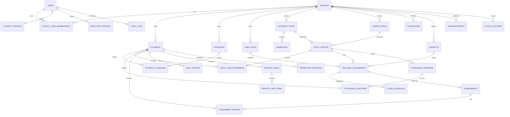

# ERD — IRNIS School (konseptual)

Diagram ini menunjukkan relasi inti. Ini bukan keseluruhan schema final; tabel modul lanjutan akan ditambahkan sesuai PRD.

## Important modeling notes
- A student can have multiple guardians and a guardian can be linked to multiple students; use `student_guardians`.
- Student class placement is historical and year-scoped through `study_group_members`; do not store a single permanent `class_id` on `students`.
- Teacher assignment is distinct from employee identity and is scoped to a school, study group, subject, and academic year.
- A final grade/report card should preserve the published result and publication metadata. Corrections must be audited.
- Use consistent naming conventions; the ERD labels are conceptual names, not necessarily final Laravel table names.
